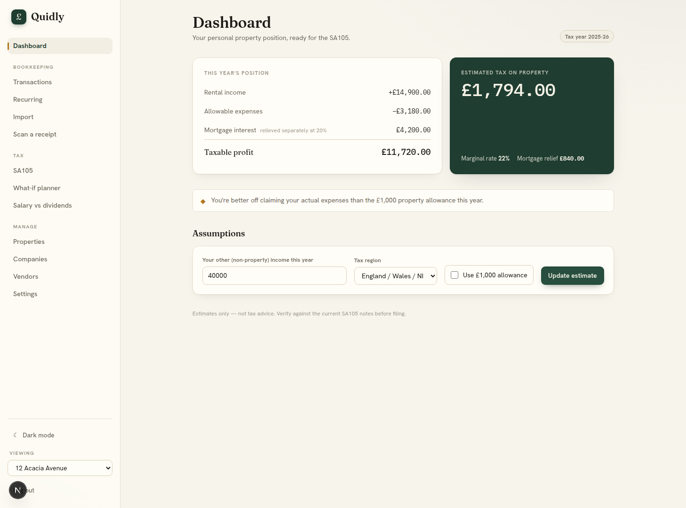
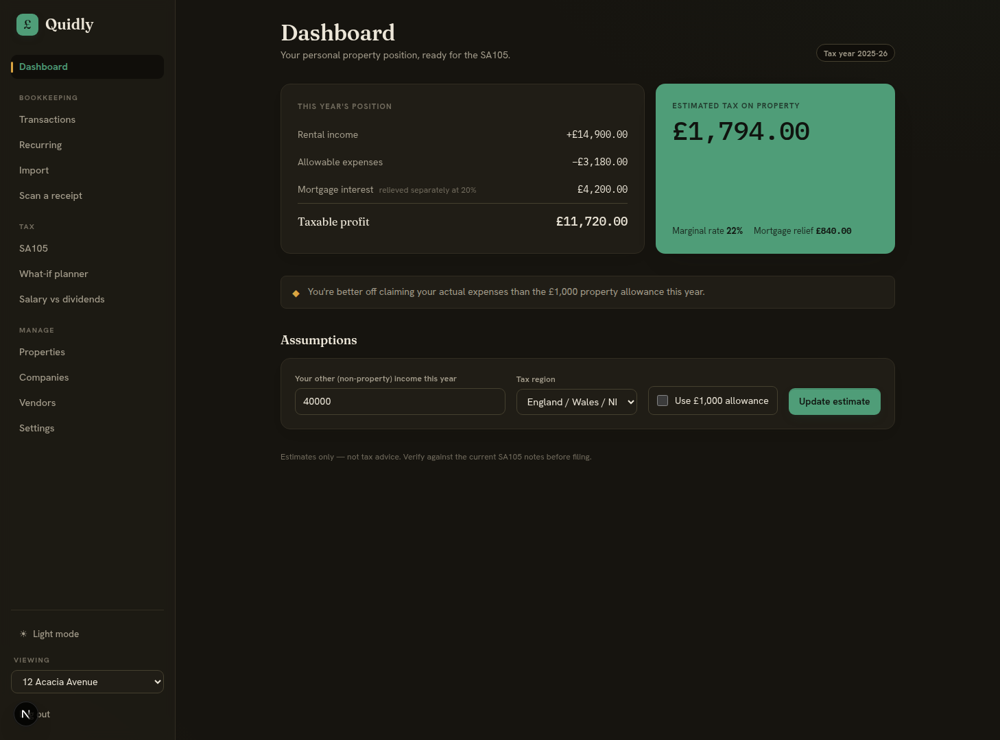
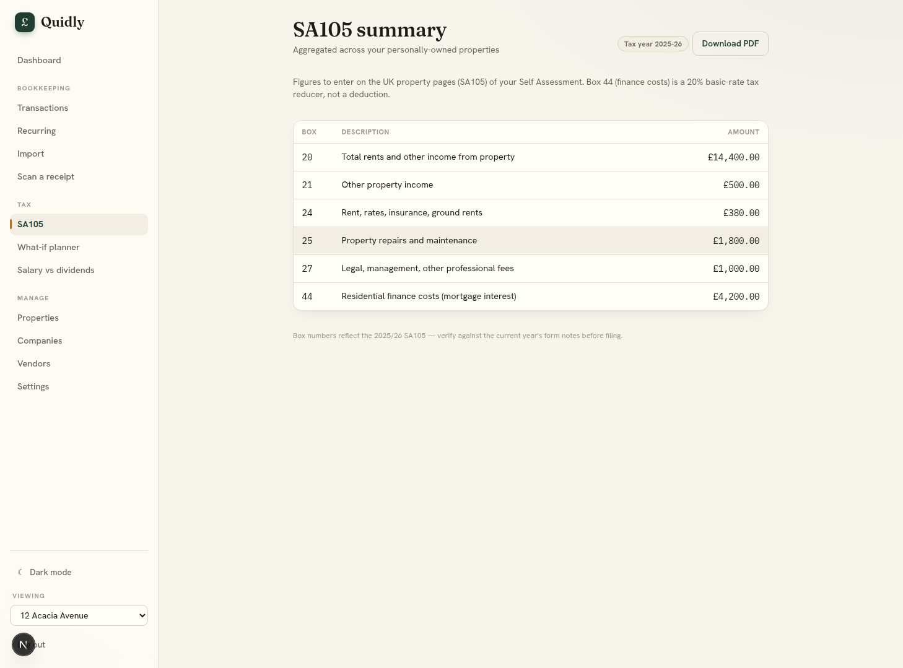
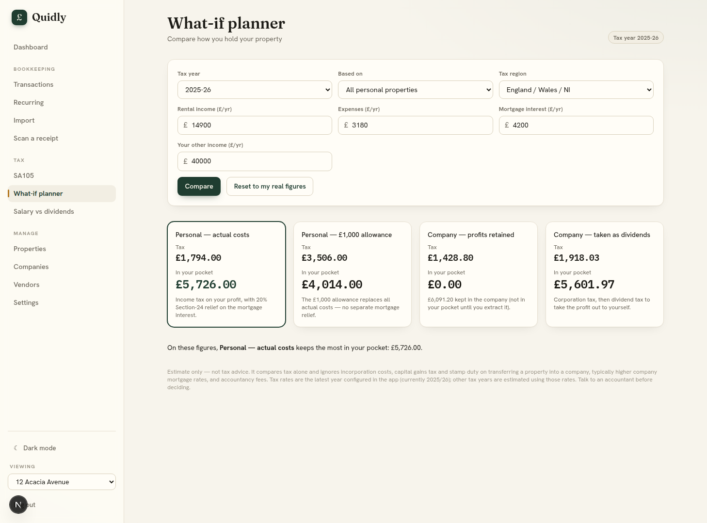

# Quidly

**Self-Assessment, sorted.** — free, self-hosted UK-landlord bookkeeping and tax.

[](https://github.com/WarlaxZ/quidly/actions/workflows/ci.yml)
[](https://github.com/WarlaxZ/quidly/releases)
[](https://github.com/WarlaxZ/quidly/pkgs/container/quidly)
[](LICENSE)


Quidly is a self-hosted **bookkeeping and tax app for UK landlords**: track rent
and expenses across your properties, then turn them into an **SA105** you can
file with your **Self Assessment** tax return. It handles the **£1,000 property
allowance**, the **Section 24** finance-cost reducer, **Scottish tax bands**, and
limited-company landlords too. Run it on your own box, keep your own data.

## Screenshots

| Light | Dark |
| --- | --- |
|  |  |





## Quick start

```bash
mkdir quidly && cd quidly
curl -O https://raw.githubusercontent.com/WarlaxZ/quidly/main/docker-compose.yml
curl -o .env https://raw.githubusercontent.com/WarlaxZ/quidly/main/.env.example
# set SESSION_SECRET in .env, then generate a login:
docker compose run --rm quidly npm run set-password   # paste the Docker-Compose hash into .env
docker compose up -d                                   # open http://localhost:3000
```

That pulls the prebuilt multi-arch image (`linux/amd64` and `linux/arm64`, so a
Raspberry Pi or ARM VPS works). See [Self-hosting](#self-hosting-with-docker)
for the `$` gotcha, HTTPS, and building from source instead.

## Who it's for

Landlords who file their own **Self Assessment** and would rather not keep the
books in a spreadsheet — whether that's one buy-to-let, an HMO, or a portfolio
across several properties, held personally or through a limited company.

If you're currently on **Akaunting**, there's a
[migration path](#migrating-from-akaunting) that brings your transactions,
vendors and categories across.

## What it is

Quidly is free and self-hosted, with a UK-first design. **Money is stored as
integer pence end-to-end** — there is no floating-point arithmetic in the money
path, so nothing drifts or rounds unexpectedly. Each install is **single-user**.
Quidly is **not affiliated with HMRC**; it produces estimates, not tax advice.

## How it compares

|  | Quidly | Spreadsheet | Landlord SaaS | General accounting software |
| --- | :---: | :---: | :---: | :---: |
| Cost | Free | Free | Monthly subscription | Monthly subscription |
| Your data stays on your hardware | ✅ | ✅ | ❌ | ❌ |
| Knows what an SA105 box is | ✅ | ❌ | Varies | ❌ |
| Section 24 finance-cost reducer | ✅ | Manual | Varies | ❌ |
| Scottish tax bands | ✅ | Manual | Varies | Varies |
| Limited-company landlord support | ✅ | Manual | Varies | ✅ |
| Won't silently mis-round your figures | ✅ | ❌ | — | — |
| Multi-user / multi-tenant | ❌ | — | ✅ | ✅ |
| Files directly with HMRC | ❌ | ❌ | Varies | Varies |

Deliberate trade-offs, not oversights: Quidly is single-user per install, UK-only,
and produces figures and a PDF rather than submitting to HMRC for you.

## Features

- **Bookkeeping** — transactions, recurring rules, one-click bank-CSV import, multi-property.
- **Mortgages & loans** — model a loan once and Quidly splits every payment into deductible
  interest (SA105 box 44) and non-deductible capital repayment, shows your effective rate
  after the Section 24 reducer, and reconciles the year against your lender's statement.
- **Receipt scanning** — optional AI extraction using your own Anthropic key.
- **SA105 & personal tax** — £1,000 property allowance, Section 24 finance-cost reducer, Scottish bands, and SA105 PDF export.
- **Limited companies** — corporation tax (including marginal relief), dividends, director's loan s455 + benefit-in-kind.
- **Deductions assistant** — mileage log and use-of-home claims.
- **Plan ahead** — a what-if planner plus a salary-vs-dividend optimiser.
- **Light & dark themes.**

## Self-hosting with Docker

The [Quick start](#quick-start) above pulls
[`ghcr.io/warlaxz/quidly`](https://github.com/WarlaxZ/quidly/pkgs/container/quidly).
To build from this checkout instead:

```bash
git clone https://github.com/WarlaxZ/quidly.git && cd quidly
cp .env.example .env                                    # then set SESSION_SECRET
docker compose -f docker-compose.yml -f docker-compose.build.yml run --rm quidly npm run set-password
docker compose -f docker-compose.yml -f docker-compose.build.yml up -d --build
```

**Password hash & the `$` gotcha.** Docker Compose interpolates bare `$` in
`env_file` values as variable references and strips them. Put the argon2 hash in
`.env` with **each `$` doubled** (`$$`). `set-password` prints exactly that
"Docker-Compose" form for you — it prints three forms in total: the dev
backslash-escaped form, the Docker-Compose doubled form, and the raw unescaped
hash. Use the Docker-Compose one here.

**Data persists** in the `quidly-data` Docker volume — the SQLite database and
uploads both live under `/data`, so they survive restarts and upgrades. Back that
volume up.

**Upgrading.** `docker compose pull && docker compose up -d`. Migrations run
automatically on start.

**`COOKIE_SECURE`.** Leave it unset (the secure default) when serving behind
HTTPS. Set `COOKIE_SECURE=false` **only** if you serve plain HTTP on a trusted
LAN, otherwise login cookies won't be sent.

**Verifying the image.** Published images carry signed build provenance:

```bash
gh attestation verify oci://ghcr.io/warlaxz/quidly:latest -R WarlaxZ/quidly
```

## HTTPS reverse proxy (Caddy)

```caddyfile
quidly.example.com {
    reverse_proxy localhost:3000
}
```

Caddy auto-provisions and renews TLS certificates for you. Behind HTTPS, leave
`COOKIE_SECURE` unset. Traefik and nginx work equally well — just point the proxy
at `localhost:3000`.

## Local development

```bash
pnpm install
pnpm run set-password            # paste the DEV (backslash-escaped) hash into .env
# .env also needs SESSION_SECRET=... (openssl rand -base64 32) and DATABASE_URL="file:./dev.db"
pnpm exec prisma migrate deploy       # apply migrations (Prisma v7: hand-authored SQL)
pnpm exec prisma db seed              # seed HMRC categories
pnpm run dev                     # http://localhost:3000

pnpm test                        # vitest
pnpm run typecheck               # tsc --noEmit
pnpm run build                   # next build
```

Prisma v7 note: the datasource URL is configured in `prisma.config.ts` (read from
`DATABASE_URL`), and migrations are hand-authored SQL applied with
`migrate deploy` — **not** `migrate dev`.

See [CONTRIBUTING.md](.github/CONTRIBUTING.md) for conventions — in particular the
integer-pence rule and the requirement that tax-rate changes cite an HMRC source.

## Migrating from Akaunting

Import your existing Akaunting data (transactions, vendors, categories) into Quidly.

**Prerequisites:** Docker (for the analyse step) and a MySQL/MariaDB dump of your
Akaunting database (`.sql`).

```bash
# 1. Analyse the dump — loads it into a throwaway MariaDB and writes a review pack
pnpm run migrate:akaunting:analyse ./akaunting-migration/dump.sql

# 2. Review akaunting-migration/report.md (incl. "what's missing") and edit
#    akaunting-migration/mapping.json — set a "target" for any unmapped category.

# 3. Dry-run (writes nothing), then apply for real
pnpm run migrate:akaunting:apply --dry-run
pnpm run migrate:akaunting:apply

# Optional: also copy receipt files from Akaunting's storage folder
pnpm run migrate:akaunting:apply --attachments-dir /path/to/akaunting/storage
```

Each Akaunting *company* becomes a Quidly *property*, categories are mapped onto
SA105 boxes (you review the suggestions), and recurring items carry across.
Amounts are treated as GBP; non-GBP transactions are listed and skipped. The
import is idempotent — re-running is safe and never duplicates (imported rows are
tagged with an `externalRef`). Files under `akaunting-migration/` are git-ignored
as they may contain financial data.

**📖 Full walkthrough: [docs/migrating-from-akaunting.md](docs/migrating-from-akaunting.md)** — how to export your Akaunting dump, review the category mapping, handle recurring items and attachments, and troubleshoot.

## Configuration

`.env.example` is the annotated source of truth; the table below summarises it.

| Variable | Required | Description |
| --- | --- | --- |
| `AUTH_USERNAME` | Yes | Login username. Generated together with the hash by `pnpm run set-password`. |
| `AUTH_PASSWORD_HASH` | Yes | argon2id password hash. Use the form matching your setup (dev / Docker-Compose / raw). |
| `SESSION_SECRET` | Yes | Long random secret (32+ chars), e.g. `openssl rand -base64 32`. |
| `DATABASE_URL` | Set by Docker | SQLite connection string. Dev default `file:./dev.db`; Docker sets `file:/data/quidly.db`. |
| `UPLOAD_DIR` | Set by Docker | Upload directory. Dev default `./uploads`; Docker sets `/data/uploads`. |
| `COOKIE_SECURE` | Optional | Set to `false` only for plain-HTTP on a trusted LAN. Leave unset behind HTTPS. |
| `ANTHROPIC_API_KEY` | Optional | Enables AI receipt scanning, using your own Anthropic key. Receipt images are sent to Anthropic; leave unset to keep everything local. |
| `EXTRACTION_MODEL` | Optional | Vision model for receipt extraction. Defaults to a cheap vision-capable Claude model. |

## Tech stack

Next.js 16 (App Router) · Prisma v7 + SQLite (better-sqlite3 adapter) · Tailwind
v4 · iron-session + argon2id · Vitest · Docker.

## Tax accuracy & caveats

Quidly produces **estimates, not advice** — verify HMRC rates each April against
the official guidance. Rates are configured for the **2025-26, 2026-27 and
2027-28** tax years; years outside that range fall back to the latest configured
year with an in-app notice.

**Finance-cost relief changes in 2027-28.** The Section 24 reducer rises from 20% to 22%
for England, Wales and Northern Ireland from 6 April 2027, alongside the matching
+2pp property-income rate surcharge. Scotland stays at 20% pending Holyrood adopting an
equivalent surcharge, so its 2027-28 figures are flagged provisional in-app.

**Quidly does not submit anything to HMRC.** It produces the figures and an SA105
PDF; you or your accountant do the filing. Making Tax Digital for Income Tax is
being phased in for landlords — check
[HMRC's guidance](https://www.gov.uk/guidance/using-making-tax-digital-for-income-tax)
for whether it applies to you yet, because Quidly cannot make quarterly digital
submissions on your behalf.

Each install is single-tenant. Found a figure that looks wrong? Please
[open a tax-accuracy issue](https://github.com/WarlaxZ/quidly/issues/new?template=tax_accuracy.yml)
with an HMRC link — those are the most useful reports this project gets.

## Contributing & security

- [CONTRIBUTING.md](.github/CONTRIBUTING.md) — conventions, scope, and what makes a good PR.
- [SECURITY.md](.github/SECURITY.md) — please report vulnerabilities privately, not as public issues.

## Licence

Licensed under [AGPL-3.0](LICENSE). Quidly is open, but the AGPL means that if
you run a modified version as a network service, you must share your changes with
its users. Commercial or hosted licensing from the author is possible if the AGPL
doesn't fit your use.
